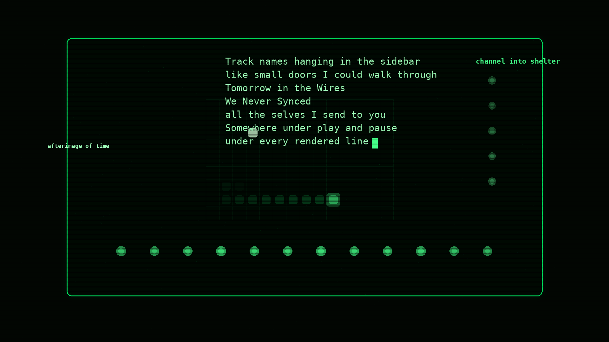

# Inside the Terminal Video Kit

Render the released `Inside the Terminal` music video yourself.

This repo is the public artifact version of the video system behind the YouTube release:

- one song
- one image pack
- one canonical config
- one reproducible render path

It is intentionally narrower than the full Nero production room.

The point of this release is not `generic video generator first`.

The point is:

`Here is the actual machine behind this music video.`



## What This Reproduces

- the released `Inside the Terminal` mixed-media terminal video
- the clean master render path
- the owned public image pack used by the release

The canonical config is `configs/inside-the-terminal.public-v1.json`.

## Setup

```bash
python3 -m venv .venv
./.venv/bin/python -m pip install --upgrade pip
./.venv/bin/python -m pip install -r requirements.txt
```

## Fastest Render

```bash
./.venv/bin/python render_inside_terminal.py
```

That writes:

- `outputs/inside-the-terminal-public-v1.mp4`
- `outputs/inside-the-terminal-public-v1.preview.png`
- `outputs/render-report.json`

## Safer Render For Ordinary Machines

```bash
./.venv/bin/python render_in_parts.py --segment-seconds 12
```

If you want to inspect the segment plan first:

```bash
./.venv/bin/python render_in_parts.py --segment-seconds 12 --list-only
```

## Repo Shape

- `render_inside_terminal.py` - main render entrypoint
- `render_in_parts.py` - resumable segment runner
- `src/terminal_video/` - render engine
- `configs/` - the frozen public config
- `assets/inside-the-terminal/` - owned public image pack used by the video
- `audio/` - the audio file used by the public config
- `lyrics/` - clean lyric source used by the public config
- `docs/` - short public notes only

## What To Swap If You Want To Experiment

If you want to keep the system but change the work:

- replace `audio/Inside the Terminal.mp3`
- replace `lyrics/inside-the-terminal.md`
- duplicate and edit `configs/inside-the-terminal.public-v1.json`
- add or replace images inside `assets/inside-the-terminal/`

The repo is still tuned to this video first, so the easiest path is:

- reproduce the public video once
- then start changing assets and config

## Notes

- this release was packaged from a larger production room
- only the public render core and required assets are included here
- the config currently assumes the DejaVu Mono fonts available on many Linux systems
- if your machine uses different font paths, update the `style.font_*` values in the config

## Signal Context

Signal is not a category. It is a room.

This repo is one door into that room.
